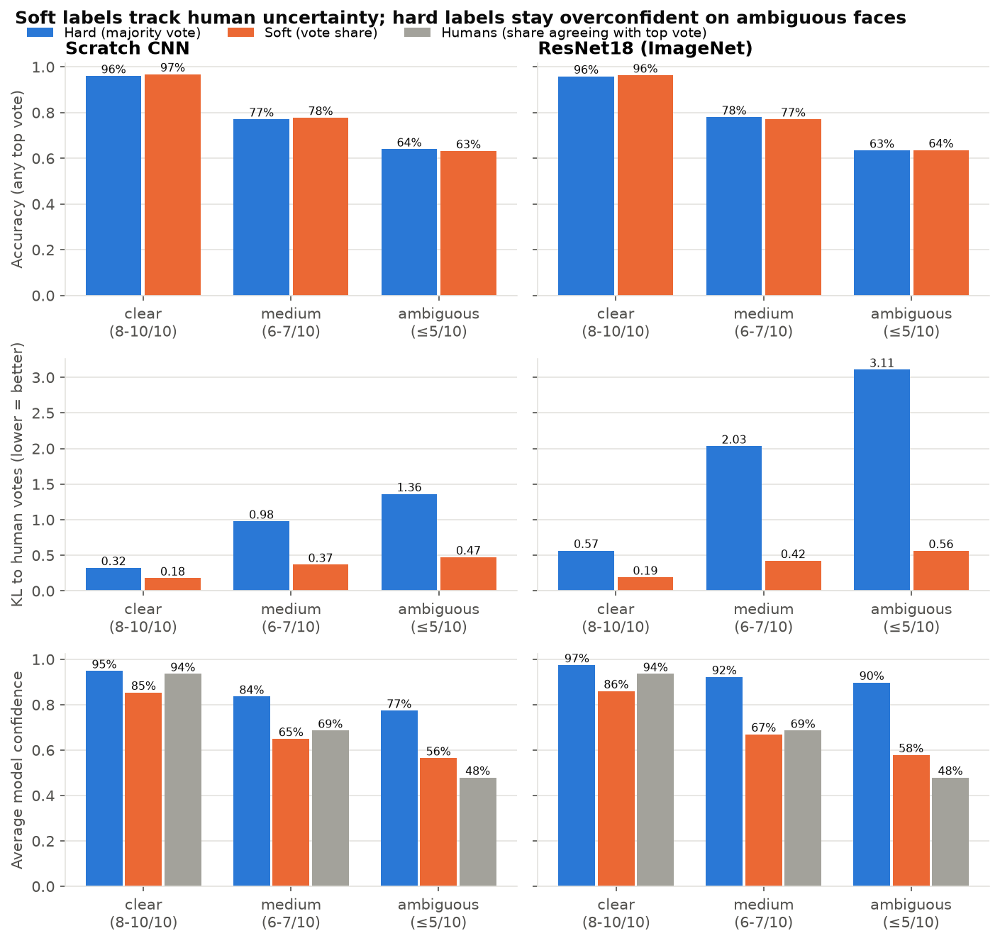
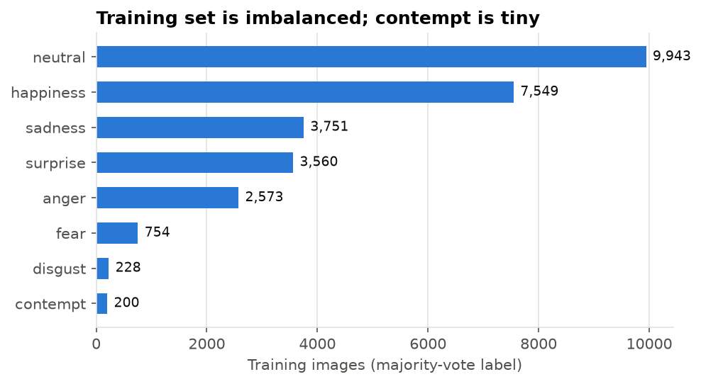
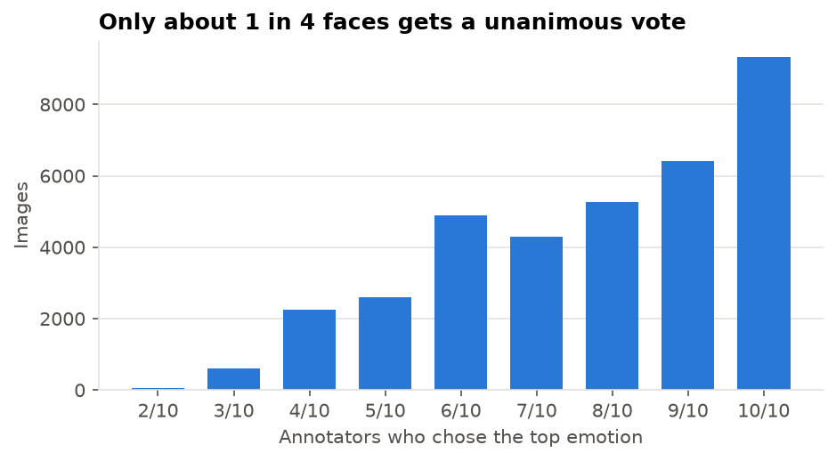
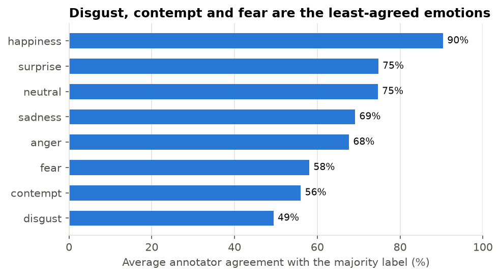
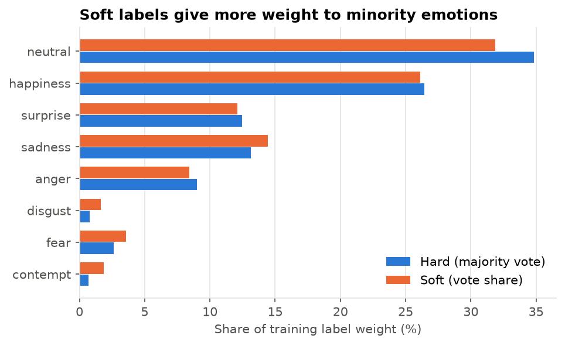
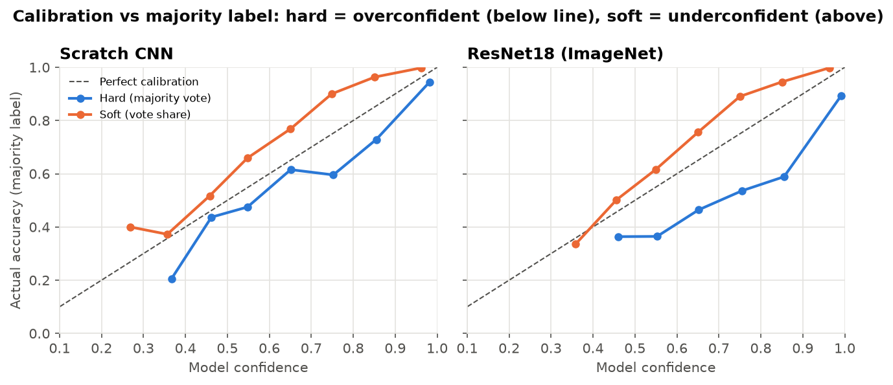
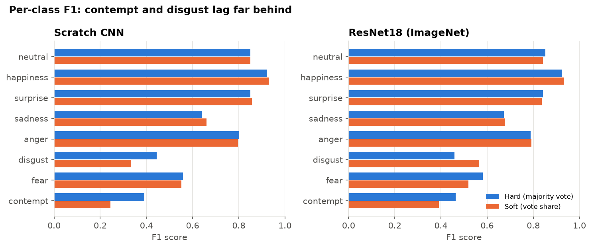

# Facial Expression Recognition: Hard vs Soft Labels on FER+

A controlled comparison of training on majority-vote (hard) labels versus the full annotator vote distribution (soft labels) on FER+, where each face was labeled by 10 annotators who often disagree. A scratch CNN and an ImageNet-pretrained ResNet18 are each trained both ways on all 8 emotion classes, evaluated for accuracy, agreement with human votes, and calibration, and the selected model drives a real-time webcam demo.

Soft labels match hard labels on accuracy (82.5–82.9%) while reducing KL divergence to human votes by 59% (CNN) and 78% (ResNet18).



## Features

- Data preparation that verifies FER2013/FER+ row alignment and builds hard and soft labels on identical images.
- Four training runs (`{cnn, resnet18} × {hard, soft}`) on Apple Silicon (`mps`) with a shared loss, schedule, augmentation, and seed.
- Evaluation on the full test set and on a de-duplicated test set: accuracy, macro and per-class F1, KL to votes, ECE, results by ambiguity, and paired bootstrap intervals.
- Real-time webcam demo (or single-image annotation) with smoothed per-emotion probability bars.
- A trained soft-label CNN (`weights/cnn_soft.pt`, 19 MB) is included, so the demo runs without the dataset.

## Method

### Data

- FER+ votes are matched to FER2013 images by row position, so `prepare_data` checks row counts and the `Usage` column row by row. As a further check, the original FER2013 label agrees with the FER+ top vote on 62.8% of rows; shifting by one row drops this to 18% (chance).
- 178 rows with no image or a top vote of "not a face" are dropped.
- **Soft label**: the 8 emotion vote counts divided by their total.
- **Hard label**: the emotion with the most votes. The 1,668 ties (4.7%) are broken randomly with a fixed seed.

### Dataset characteristics

| | |
|---|---|
|  |  |
|  |  |

- Only 26% of faces receive a unanimous vote; on 15%, the top emotion gets 5 or fewer of 10 votes.
- Contempt is the majority label for 266 of 35,709 images (0.74%): 200 in train and 34 in test. Annotator agreement on contempt averages 56%.
- Soft labels give minority emotions more total training weight: contempt's share rises from 0.7% (hard) to 1.8% (soft), since 4,006 images received at least one contempt vote.
- 279 validation and 288 test images have a pixel-identical copy in train. The official splits are kept for comparability with published work, and results are also reported without the duplicates.
- 4 filenames appear twice in `fer2013new.csv`, and 2 of those pairs are different faces. Matching is by row, so this does not affect the labels.

### Training

Hard and soft runs share images, image order, augmentation, learning-rate schedule, seed (42), and 30 epochs. A hard label is a one-hot distribution, so both use the same soft-target cross-entropy, `−Σ target × log(prediction)`. The final-epoch model is evaluated rather than a "best" epoch, since a selection rule could favor one label type. ResNet18 receives the 48×48 grayscale face upscaled and replicated to 3 channels.

## Results

Test set: FER+ PrivateTest. Full tables in [results/results.md](results/results.md); machine-readable in [results/metrics.json](results/metrics.json).

| Model | Acc (majority) | Macro F1 | KL to votes ↓ | Avg confidence |
|---|---:|---:|---:|---:|
| CNN · hard | 82.5% | 0.682 | 0.707 | 88% |
| CNN · soft | 82.9% | 0.653 | **0.288** | 74% |
| ResNet18 · hard | 82.8% | 0.698 | 1.469 | 95% |
| ResNet18 · soft | 82.5% | 0.695 | **0.327** | 75% |

Without the 288 test images duplicated in train (n = 3,285), each model loses 0.4–1.3 accuracy points and 0.02–0.05 macro F1, mostly on disgust and contempt. The hard-vs-soft conclusions are unchanged.

Findings:

1. **Accuracy: no difference.** Soft − hard accuracy ranges from −1% to +1.7%, and every 95% bootstrap interval includes 0, for both models and both test sets.
2. **Agreement with human votes: soft labels are clearly better.** KL to the vote distribution drops by 59% (CNN) and 78% (ResNet18), with intervals far from 0. The gap grows with ambiguity: on faces where at most 5 of 10 annotators agreed, hard-label ResNet18 has a KL of 3.11 versus 0.56 for soft.
3. **Hard labels produce overconfidence on ambiguous faces.** Where only 48% of annotators agree, hard-label ResNet18 averages 90% confidence; the soft-label model averages 58%.
4. **Soft labels are somewhat underconfident against the majority label.** The model hedges like the crowd, but the majority answer is correct more often than an individual annotator, so soft-label ECE is not uniformly lower (CNN: 0.088 soft vs 0.059 hard).

For applications that use the output as a confidence rather than only a top-1 label, the soft-label models are preferable: equally accurate, with probabilities that reflect real disagreement.



### Contempt



Contempt is the weakest class for every model (F1 0.24–0.46); the best model classifies 13 of 34 test images correctly. The most common error is neutral (see [the confusion matrices](results/figures/results_confusion.png)). Contributing factors: only 200 majority-contempt training images, 56% annotator agreement, and a 34-image test set in which a single prediction moves recall by 3 points.

Soft labels lowered contempt F1 (CNN 0.39 → 0.24, ResNet18 0.46 → 0.39). A plausible but untested explanation is that soft targets give partial credit to the neutral votes that typically accompany contempt, so the model rarely ranks contempt first.

## Webcam demo

Each frame is mirrored and converted to grayscale; OpenCV's Haar detector finds faces, each crop is resized to 48×48, and the model's 8 probabilities are smoothed over frames with a moving average. When the top probability is below 50%, the label shows the top two (e.g. `uncertain: neutral 41% / sadness 33%`). Bars are shown for the largest face; every detected face is labeled.

### Model selection

The demo displays a probability for every emotion, so agreement with human vote distributions is weighted above top-1 accuracy. Comparison of the two soft-label models (95% paired bootstrap interval for CNN − ResNet18):

| | Soft CNN | Soft ResNet18 | Significant difference |
|---|---:|---:|---|
| Accuracy, full test | **82.9%** | 82.5% | No: [−0.7%, +1.5%] |
| Accuracy, without duplicates | **82.5%** | 81.6% | No: [−0.2%, +2.1%] |
| KL to votes, full / without duplicates | **0.288 / 0.296** | 0.327 / 0.349 | Yes, CNN better on both |
| Macro F1, full / without duplicates | 0.653 / 0.629 | **0.695 / 0.661** | ResNet better on full; borderline without duplicates |
| Contempt / disgust F1 (full) | 0.24 / 0.33 | **0.39 / 0.57** | |
| Time per face on `mps` | **1.2 ms** | 2.4 ms | |
| Parameters | **4.7M** | 11.2M | |

The soft-label CNN is the default: its probabilities are measurably closer to human votes, its accuracy is statistically tied, and it is 2× faster and less than half the size (both are well within a 33 ms frame budget). ResNet18 is stronger on rare classes, particularly disgust and contempt, and can be selected with `--model resnet18_soft`.

## Quickstart

```bash
conda create -n facial-expression-recognition python=3.11 -y
conda activate facial-expression-recognition
pip install -r requirements.txt
python -m src.webcam                         # uses the shipped soft-label CNN; press q to quit
```

```bash
python -m src.webcam --image photo.jpg       # annotate a photo
python -m src.webcam --model resnet18_soft   # requires a local training run in runs/
python -m src.webcam --margin 0.1            # loosen the face crop
```

macOS requests camera access for the terminal application on first use. If denied, enable it under System Settings → Privacy & Security → Camera and restart the terminal.

### Full pipeline

Place both files in `data/raw/`:

- `fer2013.csv` from the Kaggle FER2013 challenge (the CSV version; the image-folder version loses row order)
- `fer2013new.csv` from https://github.com/microsoft/FERPlus

```bash
python -m src.prepare_data                         # verify alignment, build data/processed/ferplus.npz
python -m src.explore                              # figures and results/data_summary.md
python -m src.train --model cnn --labels hard      # one of 4 runs, ~10–17 min each on mps
python -m src.evaluate                             # results/results.md, metrics.json, figures
```

The four runs are every combination of `--model {cnn,resnet18}` and `--labels {hard,soft}`.

## Running tests

```bash
python -m pytest
```

22 tests covering label building, tie-breaking, row dropping, and alignment checks; model output shapes, loss correctness, and augmentation; KL, calibration error, tie-aware accuracy, and ambiguity buckets; and webcam face preprocessing, smoothing, and uncertain-label formatting.

## Project structure

```
facial-expression-recognition/
├── data/                         Not tracked (dataset license and size)
│   ├── raw/fer2013.csv           35,887 faces as pixel strings with the official split
│   ├── raw/fer2013new.csv        FER+ votes (10 annotators per face)
│   └── processed/ferplus.npz     Images with hard and soft labels
├── results/
│   ├── data_summary.md           Class counts, ambiguity, contempt, duplicates
│   ├── results.md                All test-set tables (full and de-duplicated)
│   ├── metrics.json              Same numbers, machine-readable
│   └── figures/                  Exploration and result charts
├── runs/                         Not tracked: checkpoints and training history
├── weights/cnn_soft.pt           Trained soft-label CNN for the demo
├── src/
│   ├── config.py                 Paths, class names, constants
│   ├── data.py                   Alignment check, label building, loading
│   ├── prepare_data.py           Verifies CSVs and saves ferplus.npz
│   ├── explore.py                Exploration figures and data_summary.md
│   ├── models.py                 Scratch CNN and ResNet18 (48×48 grayscale input)
│   ├── train.py                  Trains one model on hard or soft labels
│   ├── evaluate.py               Test-set metrics for all four models
│   ├── report.py                 Writes results.md and result figures
│   └── webcam.py                 Real-time demo or single-image annotation
├── tests/
│   ├── test_data.py
│   ├── test_models.py
│   ├── test_evaluate.py
│   └── test_webcam.py
└── requirements.txt
```

## Design decisions

- **Controlled experiment.** Only the label type differs between paired runs; images, order, augmentation, schedule, seed, and epoch count are fixed.
- **Shared loss.** Soft-target cross-entropy handles both label types, avoiding a confound from different loss functions.
- **KL to votes as the primary ambiguity metric**, since accuracy against the majority label cannot measure how well a model represents disagreement.
- **Per-class F1 reported alongside accuracy**, since contempt and disgust have about 200 training examples each versus about 10,000 for neutral.
- **Official splits kept, de-duplicated results also reported**, to stay comparable with published work while quantifying leakage.
- **OpenCV pinned below 5.0**, since 5.x no longer ships the Haar face detector.

## Limitations and future work

- **One training run per model (seed 42).** Bootstrap intervals cover test-set sampling, not training randomness; small differences such as rare-class F1 could change with another seed.
- **No hyperparameter tuning.** Both label types use the same hyperparameters, chosen in advance and evaluated at the final epoch.
- **Domain shift.** FER2013 faces are tightly cropped web images, often posed. Webcam lighting, angles, and crops differ, so live accuracy is lower than test-set accuracy.
- **Rare classes drift toward neutral in live use.** On the test set, the soft CNN labels 44% of contempt faces as neutral; neutral is 35% of the training data.
- **Prior correction (not implemented).** Dividing each probability by its class's training share raised to τ, then renormalizing, improves rare classes at τ = 0.5 (anger 80% → 85%, contempt 15% → 26%, disgust 30% → 56%, fear 47% → 62%) while reducing overall accuracy (82.9% → 81.4%) and neutral (90% → 81%). At τ = 1 it overcorrects (72.7% accuracy). Because it moves the bars away from human vote distributions, it would be an opt-in `--balance` option.
- Other directions: class weighting or oversampling, multiple training seeds, a stronger face detector (e.g. OpenCV YuNet) for tilted faces, and fine-tuning on labeled webcam frames.
